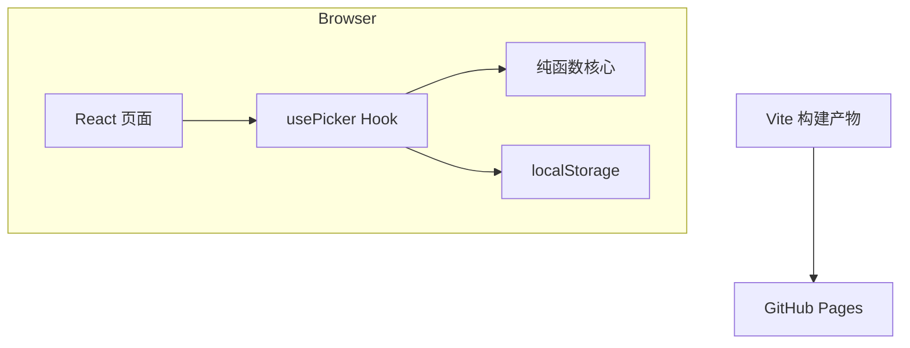
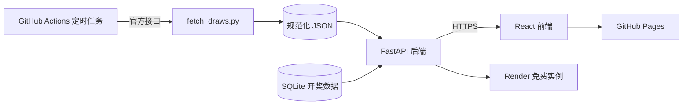

# 架构概览

## 当前形态

Lucky Picks 是一个纯前端静态单页应用，无后端、无数据库、无鉴权。所有号码生成、组合计算与分布分析在浏览器内执行；用户主动保存的结果存放于 `localStorage`。

## 代码分层

| 层 | 位置 | 职责 |
|---|---|---|
| 页面 | `frontend/src/App.tsx` | 组合布局、模式切换、结果与历史展示 |
| Hook | `frontend/src/features/picker/hooks/` | 选号状态、参数校验、生成与保存动作 |
| 核心 | `frontend/src/features/picker/*.ts` | 玩法配置、随机、组合、分析、格式化（纯函数） |
| 存储 | `frontend/src/services/storage.ts` | 历史读写、异常降级 |

## 关键约束

- 核心逻辑不得依赖 React 或浏览器 API，必须可独立单测。
- 前端不发起任何网络请求，不采集个人信息。
- 生成类函数必须校验参数并限制组合数量，避免浏览器卡死。
- UI 使用 Ant Design 5 现有组件，不自创视觉体系。

## 部署

GitHub Actions 在 `main` 推送后执行安装、测试、构建，并将 `frontend/dist` 发布到 GitHub Pages。线上地址：<https://hotpotcloud.github.io/lucky-picks/>。

## FEAT-002 目标架构（设计阶段，未实现）

FEAT-002 将引入 Python FastAPI 后端、官方开奖数据与全玩法/推荐/回测能力。当前线上仍是上文的纯前端 v1；以下为目标形态，详见 `docs/features/FEAT-002/design-backend.md`。

关键变化：

- 规则与金额以服务端为权威，前端做即时预校验。
- 推荐算法：统计特征 + 约束采样 + 覆盖设计 + walk-forward 回测；明确不改变单注期望。
- 数据：官方公开接口，低频抓取，失败保留旧数据；前端支持离线快照降级。
- 全玩法：单式/复式/胆拖（含分区）/追加/倍数/官方金额上限。

## 后续演进

- FEAT-002（设计中）：历史数据、推荐算法、全玩法、Python 后端；见 `docs/features/FEAT-002/`。
- FEAT-003（候选）：走势图、模型对比、覆盖设计、报告导出等；见 `docs/features/FEAT-003/backlog.md`。
