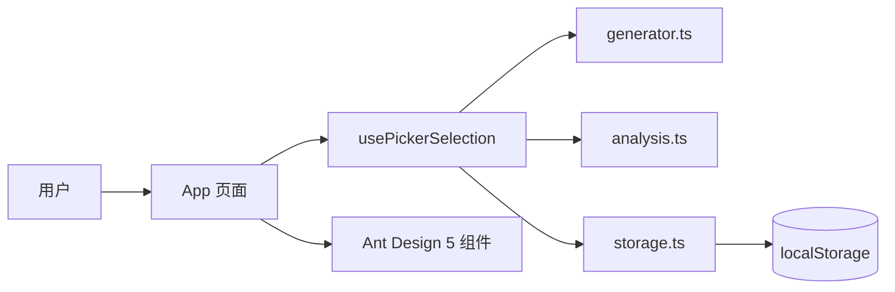

# FEAT-001 设计（单人全栈 · 垂直切片）

- 关联需求：`docs/features/FEAT-001-number-advisor/requirement.md`
- 关联用例：`docs/features/FEAT-001-number-advisor/test-cases.md`
- 任务卡：`docs/features/FEAT-001-number-advisor/tasks.md`

## 1. 总体方案

纯前端静态单页应用（SPA），所有号码生成、组合计算、分布分析都在浏览器内完成。无后端、无数据库、无外部接口，因此不存在契约文件与网络错误处理，接口层由「纯函数模块 + 前端类型定义」承担。



## 2. 技术选型

| 项 | 选择 | 说明 |
|---|---|---|
| 构建 | Vite 5 | 冷启动快，静态产物简单 |
| 框架 | React 18 + TypeScript 5 | 团队默认真实技术栈 |
| UI | Ant Design 5 | 无设计稿时使用现有组件库，不自创样式 |
| 测试 | Vitest + @testing-library/react | 纯函数单测 + 少量组件测试 |
| 代码检查 | ESLint 9 flat config + tsc --noEmit | CI 门禁 |
| 部署 | GitHub Pages + GitHub Actions | 免费 `github.io` 域名 |
| 存储 | localStorage | 仅保存用户主动保存的号码 |

## 3. 目录与文件

```text
frontend/
├── index.html
├── package.json
├── vite.config.ts              # base 路径按构建模式切换
├── tsconfig.json
├── eslint.config.js
└── src/
    ├── main.tsx                # 应用入口与 antd ConfigProvider
    ├── App.tsx                 # 页面入口（只做组合，不写业务计算）
    ├── index.css               # 全局基础样式
    ├── features/picker/
    │   ├── types.ts            # 玩法配置、号码、组合、分析等类型
    │   ├── config.ts           # 红蓝玩法 / 前后玩法规则常量
    │   ├── random.ts           # 可注入随机源的随机工具
    │   ├── generator.ts        # 机选、复式、胆拖、组合数计算
    │   ├── analysis.ts         # 奇偶/大小/和值/三区比
    │   ├── format.ts           # 号码文本化与复制格式
    │   ├── constants.ts        # 注数上限、单价、策略等常量
    │   ├── generator.test.ts   # 生成逻辑单测
    │   ├── analysis.test.ts    # 分析逻辑单测
    │   ├── format.test.ts      # 格式化单测
    │   ├── hooks/usePicker.ts # 选号状态与动作
    │   └── components/
    │       ├── GameSwitcher.tsx
    │       ├── QuickPickPanel.tsx
    │       ├── MultiplePanel.tsx
    │       ├── BankerPanel.tsx
    │       ├── TicketList.tsx
    │       ├── HistoryList.tsx
    │       └── NumberBall.tsx
    └── services/storage.ts     # 历史记录读写与异常降级
```

## 4. 核心数据模型

```ts
// 玩法唯一标识
type GameId = 'redblue' | 'frontback';

// 单个区域的规则：范围、基础号码个数、名称、球的颜色语义
interface BallArea {
  key: 'red' | 'blue' | 'front' | 'back';
  label: string;      // 展示名称，如「红球」
  min: number;        // 最小编号（含）
  max: number;        // 最大编号（含）
  count: number;      // 单注基础个数
}

// 一个玩法的完整规则
interface GameConfig {
  id: GameId;
  name: string;        // 玩法名称
  description: string; // 规则说明
  areas: BallArea[];   // 通常 2 个区域
}

// 一注号码：区域 key -> 升序号码数组
type Ticket = Record<string, number[]>;

// 分析结果
interface TicketAnalysis {
  oddEven: string;        // 如 4:2（仅主区）
  bigSmall: string;       // 如 3:3（仅主区）
  sum: number;            // 主区和值
  zones: string;          // 如 2:2:2（主区三区比）
}
```

## 5. 算法设计

### 5.1 机选（随机 / 均衡）

- 随机：对每个区域使用 Fisher–Yates 部分洗牌，取前 `count` 个，升序返回。
- 均衡：重复采样 `BALANCED_SAMPLE_SIZE` 次候选，按目标指标打分，取分数最小者：
  - 奇偶比目标：主区奇数个数接近 `count / 2`。
  - 大小比目标：主区大于中位数的个数接近 `count / 2`。
  - 和值目标：接近「最小和 + 最大和」的中点。
  - 三区分布目标：主区各区间个数尽量平均。
  - 分数 = 各项偏差绝对值之和，越小越好；同分随机取一个。
  - 单号/双号区域（蓝球、前后玩法后区）不套用均衡目标，直接随机，避免退化为固定号码。
- 随机源可注入，单测使用固定序列保证可重复。

### 5.2 复式

- 校验每个区域选择数 ≥ 基础数且 ≤ 区域上限。
- 组合数 = 各区域 `C(选择数, 基础数)` 的乘积。
- 超过 `MAX_TICKETS`（1000）时禁止生成。
- 展示时只展示用户选择的号码集合，标注「复式」及组合数、金额。

### 5.3 胆拖

- 主区胆码数 `b` 必须满足 `1 ≤ b < count`；拖码数 `d` 必须满足 `d ≥ count - b`。
- 组合数 = `C(d, count - b) × 其他区域组合数`（其他区域按普通选号计算）。
- 生成时对拖码做组合枚举，每注 = 排序后的「胆码 + 组合拖码」。
- 超过 `MAX_TICKETS` 时禁止生成，提示减少拖码。

### 5.4 分析

- 奇偶比：主区奇数个数 : 偶数个数。
- 大小比：主区大于等于大小分界阈值的个数 : 其余个数（红蓝玩法大号 17–33，前后玩法大号 18–35）。
- 和值：主区号码之和。
- 三区比：把主区范围三等分，统计各区个数。
- 分析仅用于展示，不参与中奖判断。

## 6. 页面规格

页面目的：单页完成「选玩法 → 选模式 → 设置参数 → 生成 → 查看/复制/保存」。

展示数据：
- 顶部：产品名、玩法切换、免责声明（始终可见）。
- 规则说明：当前玩法区域、范围、单注数量、2 元/注提示。
- 模式切换：机选 / 复式 / 胆拖。
- 参数区：按模式展示注数、策略或号码选择器；实时显示组合数与金额。
- 结果区：号码球、分析指标、复制/保存按钮；空状态提示。
- 历史区：本地保存记录，支持删除单条与清空。

交互：
- 切换玩法清空所有已选号码与结果，并重置参数到合法默认值。
- 生成按钮在参数非法时禁用，并在参数区展示具体原因。
- 复制成功/失败、保存成功、清空确认均使用 antd `message` / `Modal.confirm`。

状态：

| 状态 | 处理 |
|---|---|
| 加载 | 纯前端无远程加载；生成耗时 < 100ms，不做 loading，靠参数校验禁用按钮防误操作 |
| 空 | 结果区显示「尚未生成号码」；历史区显示「暂无历史记录」 |
| 错误 | 参数错误就地提示；存储异常提示「本地存储不可用，历史功能已禁用」 |
| 无权限 | 不适用（无账号体系） |
| 成功 | 号码球 + 分析 + 可复制/保存 |

响应式：≥ 768px 双列布局（参数 + 结果），< 768px 单列；号码球自适应换行；最小支持 360px。

使用组件：`Layout`、`Card`、`Segmented`、`Radio.Group`、`InputNumber`、`Select`、`Button`、`Tag`、`List`、`Empty`、`Alert`、`Space`、`Typography`、`Divider`、`Modal`、`message`。

## 7. 错误处理与边界

- 生成函数在参数非法时抛出带中文可读信息的 `SelectionError`，由 Hook 转为界面提示；复式/胆拖的校验函数返回 `SelectionInfo` 供实时展示。
- 组合数使用组合公式计算，超过上限直接拒绝，避免枚举造成浏览器卡死。
- 随机数范围使用闭区间 `[min, max]`，并对 `count > 范围长度` 做防御。
- localStorage 读写包裹 try/catch；读取与写入分别判断可用性，只读时不误报「存储被禁用」；JSON 解析失败时返回空数组并清理损坏数据。
- 历史记录会校验玩法、区域、号码范围、整数与时间有效性，语义损坏的数据直接丢弃。
- 单条历史最多保存 200 注号码（组合注数仍为真实值），超出时明确提示用户及时复制完整结果。
- 剪贴板 API 不可用或拒绝时提示「复制失败，请手动选择号码」。

## 8. 测试策略

- 纯函数单测：生成合法性、数量、均衡容差、组合数、胆拖含胆码、分析指标、格式化、存储异常。
- 组件测试（少量）：免责声明渲染、非法参数禁用生成、切换玩法清空。
- 手工验证：360px 响应式、复制、刷新后历史、GitHub Pages 线上访问。
- 门禁命令：`pnpm lint`、`pnpm typecheck`、`pnpm test`、`pnpm build`。

## 9. 部署方案

- GitHub Actions：PR 与 `main` 推送都执行 lint、类型检查、单测、构建；仅 `main` 推送执行 Pages 部署。
- Vite `base` 在生产构建为 `/lucky-picks/`，匹配项目页路径。
- 首次部署需在仓库 Settings → Pages 将 Source 设为 GitHub Actions。
- 回滚：在 GitHub Actions 重新运行上一个成功部署，或 revert 提交后重新部署。
- 监控：静态站点无服务端指标；上线后用访问检查与浏览器控制台检查资源 404。

## 10. 风险与说明

| 风险 | 影响 | 措施 |
|---|---|---|
| 用户误解为「预测中奖」 | 合规与信任风险 | 固定免责声明，禁止误导文案 |
| 免费托管限制 | 无法部署后端 | v1 纯前端；后端作为后续特性 |
| 本地历史丢失 | 换设备/清缓存后记录消失 | 页面说明「仅保存在本机浏览器」 |
| 组合枚举过大 | 浏览器卡顿 | 1000 注上限，超限拦截 |
| 历史截断导致号码丢失 | 用户误以为完整保存 | 单条最多 200 注，保存与历史复制均明确提示 |

## 11. 本轮不动项

- 不接入任何第三方开奖数据接口。
- 不引入路由、状态管理库、后端服务。
- 不做主题切换、国际化、账号体系。
- 不修改仓库根目录研发流程文档。
