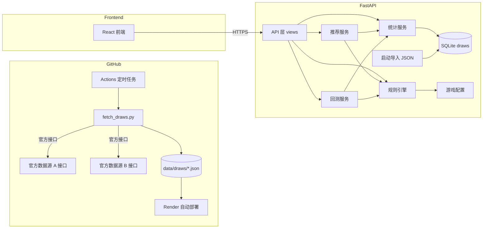

# FEAT-002 设计（后端）：FastAPI 数据、规则、统计、推荐与回测

- 关联需求：`docs/features/FEAT-002/requirement.md`
- 关联契约：`docs/contracts/openapi.yaml`
- 关联前端设计：`design-frontend.md`
- 关联任务：`tasks.md`

## 1. 目标与边界

后端负责「权威规则 + 数据 + 统计 + 推荐 + 回测」，前端只做展示与交互：

- 规则与金额计算以服务端为准，前端做同样的即时预校验，但最终以 `/bets/validate` 为准。
- 推荐算法只在服务端运行，输出号码、注数、金额、解释、数据版本与 seed。
- 无账号、无写入型业务数据；开奖数据来自官方公开接口，经 GitHub Actions 规范化后随代码发布。
- 不在 FEAT-002 训练深度模型；预留策略接口与回测框架。

## 2. 技术选型

| 项 | 选择 | 说明 |
|---|---|---|
| Python | 3.11+ | 团队规范 |
| Web | FastAPI + Uvicorn | 类型化、OpenAPI 原生 |
| 校验 | Pydantic v2 | 请求/响应模型 |
| 数据访问 | SQLModel + SQLite | 开奖数据查询；无用户数据 |
| HTTP | httpx + tenacity | 抓取官方接口、重试 |
| 日志 | loguru | 结构化、异常堆栈 |
| 限流 | slowapi 或自研中间件 | 保护推荐/回测 |
| 测试 | pytest + pytest-asyncio + httpx | 单测/API/契约 |
| Lint | ruff + pyright | 门禁 |
| 部署 | Docker + Render 免费 Web Service | 需账号；备选 Fly.io |
| 数据任务 | GitHub Actions | 定时抓取、校验、提交 JSON |

## 3. 架构



## 4. 目录结构

```text
backend/
├── app/
│   ├── common/
│   │   ├── schemas.py          # 通用响应、分页
│   │   ├── response.py         # 统一响应封装
│   │   ├── exceptions.py       # 业务异常与错误码
│   │   ├── consts.py
│   │   └── enums.py            # GameId / Mode / Strategy / ErrorCode
│   ├── config/
│   │   ├── config.py           # 环境变量
│   │   └── .env.example
│   ├── games/
│   │   ├── config.py           # 红蓝玩法/前后玩法规则配置
│   │   ├── rules.py            # 合法性、组合数、金额
│   │   ├── prizes.py           # 奖级表（回测）
│   │   ├── schemas.py
│   │   └── views.py            # GET /games
│   ├── draws/
│   │   ├── adapters/
│   │   │   ├── base.py         # 数据源接口
│   │   │   ├── source_a.py     # 官方数据源 A 适配器
│   │   │   └── source_b.py     # 官方数据源 B 适配器
│   │   ├── service.py          # 导入、查询、最新一期
│   │   ├── crud.py
│   │   ├── schemas.py
│   │   └── views.py
│   ├── stats/
│   │   ├── service.py          # 频率/遗漏/分布/卡方
│   │   ├── schemas.py
│   │   └── views.py
│   ├── recommend/
│   │   ├── service.py
│   │   ├── strategies/
│   │   │   ├── base.py
│   │   │   ├── balanced.py
│   │   │   ├── hot.py
│   │   │   ├── cold.py
│   │   │   ├── omission.py
│   │   │   ├── bayesian.py
│   │   │   └── coverage.py
│   │   ├── constraints.py
│   │   ├── explain.py
│   │   ├── schemas.py
│   │   └── views.py
│   ├── backtest/
│   │   ├── service.py
│   │   ├── schemas.py
│   │   └── views.py
│   ├── db/
│   │   ├── models.py           # Draw / IngestLog
│   │   └── database.py
│   ├── middleware/
│   │   ├── request_id.py
│   │   └── logging.py
│   ├── utils/
│   │   ├── logger.py
│   │   ├── combinatorics.py
│   │   └── rng.py
│   └── main.py
├── data/
│   ├── draws/redblue.json          # 规范化开奖数据（提交到仓库）
│   ├── draws/frontback.json
│   └── meta.json               # 数据版本、更新时间、来源
├── scripts/fetch_draws.py
├── tests/
│   ├── unit_test/
│   ├── api_test/
│   ├── e2e_test/
│   └── fixtures/
├── Dockerfile
├── requirements.txt
├── pyproject.toml
└── .env.example
```

## 5. 数据模型

```python
class Draw(SQLModel, table=True):
    id: int | None = Field(default=None, primary_key=True)
    game: str = Field(index=True)              # ssq / dlt
    issue: str = Field(index=True)             # 期号
    draw_date: date = Field(index=True)
    numbers: dict                              # {"red": [...], "blue": [...]}
    sales: int | None = None
    pool: int | None = None
    source: str                                # source_a / source_b
    fetched_at: datetime
    # 唯一约束 (game, issue)
```

规范化 JSON 结构：

```json
{
  "game": "redblue",
  "version": "2026-11-23T13:30:00Z",
  "source": "official-source-a",
  "draws": [
    {
      "issue": "2026134",
      "date": "2026-11-22",
      "numbers": { "red": [4, 5, 10, 17, 21, 32], "blue": [8] },
      "sales": 435713586,
      "pool": 1154982023
    }
  ]
}
```

- 启动时读取 `data/draws/*.json`，按 `(game, issue)` upsert 到 SQLite；`meta.json` 的 `version` 用于判断是否需要重新导入。
- SQLite 文件不入库；容器重启后从 JSON 重建，保证无状态。
- 数据保留全部可抓取期数（至少 500 期），排序按期号/日期倒序。

## 5.1 数据库选型（已按需求提出方决定改为 MariaDB）

**结论：生产使用 MariaDB（pymysql 驱动），测试与本地离线抓取可用 SQLite 内存库。**

参考内存占用（用户提供的评估）：SQLite 约 2MB 缓存；Redis 空实例 1–3MB 但纯内存不适合作为事实源；MongoDB 空实例 50–100MB；MySQL/MariaDB 空实例 100–400MB（InnoDB 缓冲池默认 128MB 起）；PostgreSQL 约 30–60MB 但 shared_buffers 默认 128MB。本项目数据量（约 5000 期开奖记录）对 MariaDB 而言极小，用户已明确选择 MariaDB 作为生产数据库。

实现约束：

- 生产默认 `DB_TYPE=mariadb`，连接参数由 `DB_HOST/DB_PORT/DB_USER/DB_PASSWORD/DB_NAME` 提供。
- 数据层用连接封装统一 `?`（SQLite）与 `%s`（pymysql）占位符、DictCursor 与 Row；建表语句按方言选择 `AUTO_INCREMENT` / `AUTOINCREMENT`，UPSERT 按方言选择 `ON DUPLICATE KEY UPDATE` / `ON CONFLICT DO UPDATE`。
- 三张表：`draws`（全部可获取的历史期次，主键 game+issue）、`users`（账号，PBKDF2 加盐哈希）、`settings`（键值配置，含令牌签名密钥）。
- 默认账号 `admin` / `888888` 在用户表为空时自动创建；登录后请尽快修改密码。
- 免费/本地部署可用 `backend/docker-compose.yml` 启动 MariaDB 11.4；正式部署由需求提出方提供数据库实例。
- 抓取脚本 `scripts/fetch_draws.py` 按 `DB_TYPE` 选择数据库，把**能获取到的每一期**都写入（重复抓取 UPSERT），并导出规范化 JSON 快照供前端离线使用。

## 6. 数据抓取与更新

### 6.1 适配器接口

```python
class DrawSource(Protocol):
    game: GameId
    async def fetch(self, limit: int) -> list[RawDraw]: ...
```

- 官方数据源 A：开奖历史查询接口，支持分页拉取，字段语义为「期号 / 开奖日期 / 主区号码 / 副区号码 / 销售额 / 奖池余额」。
- 官方数据源 B：开奖历史查询接口，字段语义为「期号 / 开奖号码 / 开奖时间 / 销售额 / 奖池余额」。
- 请求头带 UA 与官方 Referer；超时 10s，重试 3 次（指数退避）；失败不写文件。
- 校验：期号唯一、号码数量/范围/不重复、日期可解析、开奖结果长度正确；不合法整批拒绝。

### 6.2 GitHub Actions

```yaml
on:
  schedule:
    - cron: "30 14 * * 2,4,0"   # 红蓝玩法开奖后（北京时间 22:30）
    - cron: "30 14 * * 1,3,6"   # 前后玩法开奖后
  workflow_dispatch:
permissions:
  contents: write
```

- 运行 `python backend/scripts/fetch_draws.py --game all --limit 30`。
- 仅在数据有变化时提交 `backend/data/**`；提交信息 `chore(data): 更新开奖数据 [FEAT-002]`。
- 若 main 开启分支保护，改为「抓取 → 上传 artifact → 由人工/机器人 PR 合并」，或部署流程直接使用 artifact；不得绕过保护。
- 失败：Actions 失败并在 step summary 输出原因；旧数据保持不变。

## 7. 规则引擎

### 7.1 配置

```python
AreaRule(
    key="red", label="红球", min=1, max=33, base_count=6,
    banker_min=1, banker_max=5, color="red",
)
GameRule(
    id="redblue", name="红蓝玩法", price=2, additional_price=0,
    multiplier_min=1, multiplier_max=99,
    base_amount_limit=20000, total_amount_limit=20000,
    areas=[red, blue],
)
```

前后玩法：`price=2, additional_price=1, base_amount_limit=20000, total_amount_limit=30000`；前区 `banker_min=1,max=4`，后区 `banker_min=1,max=1`。

### 7.2 校验与金额

请求：

```json
{
  "game": "redblue",
  "mode": "banker",
  "multiplier": 2,
  "additional": false,
  "areas": [
    { "key": "red", "numbers": [3,4,5,6,7,8,9], "banker": [3,4] },
    { "key": "blue", "numbers": [8], "banker": [] }
  ]
}
```

算法：

1. 号码去重、范围、区域存在性校验。
2. 模式校验：
   - `single`：各区域 `len == base_count`，禁止胆码。
   - `multiple`：各区域 `len >= base_count`，至少一个区域 `len > base_count`，禁止胆码。
   - `banker`：至少一个区域有胆码；有胆码区域 `banker_len ∈ [banker_min, banker_max]`，`drag_len >= base_count - banker_len + 1`；无胆码区域按复式/单式校验（`len >= base_count`）。
3. 组合数：
   - 无胆码区域：`C(len, base_count)`
   - 有胆码区域：`C(drag_len, base_count - banker_len)`
   - 总注数 = 各区域乘积。
4. 金额：

```text
base_amount = combinations × price × multiplier
additional_amount = additional ? combinations × additional_price × multiplier : 0
total_amount = base_amount + additional_amount
```

5. 上限：红蓝玩法 `total_amount <= 20000`；前后玩法 `base_amount <= 20000` 且 `total_amount <= 30000`；倍数 1–99。
6. 安全上限：组合数超过 `MAX_COMBINATIONS = 10_000_000` 直接拒绝，避免计算/传输异常。
7. 返回：`combinations, baseAmount, additionalAmount, totalAmount, mode, normalizedAreas, warnings`。

### 7.3 奖级表（回测）

**红蓝玩法（6 个奖级）**

| 奖级 | 中奖条件（红+蓝） | 奖金 |
|---|---|---|
| 一等奖 | 6+1 | 浮动，封顶 500 万/注 |
| 二等奖 | 6+0 | 浮动，封顶 500 万/注 |
| 三等奖 | 5+1 | 3000 元 |
| 四等奖 | 5+0 或 4+1 | 200 元 |
| 五等奖 | 4+0 或 3+1 | 10 元 |
| 六等奖 | 2+1、1+1、0+1 | 5 元 |

**前后玩法（9 个奖级）**

| 奖级 | 中奖条件（前+后） | 基本奖金 |
|---|---|---|
| 一等奖 | 5+2 | 浮动 |
| 二等奖 | 5+1 | 浮动 |
| 三等奖 | 5+0 | 10000 元 |
| 四等奖 | 4+2 | 3000 元 |
| 五等奖 | 4+1 | 300 元 |
| 六等奖 | 3+2 | 200 元 |
| 七等奖 | 4+0 | 100 元 |
| 八等奖 | 3+1 或 2+2 | 15 元 |
| 九等奖 | 3+0、2+1、1+2、0+2 | 5 元 |

- 固定奖按官方；浮动奖（红蓝玩法一/二等奖、前后玩法一/二等奖）用可配置估计值并在响应中标记 `estimated=true`。
- 前后玩法追加：回测可选择是否计入追加；追加奖金按官方规则计算，无法确定浮动部分时明确标注估算。
- 奖级表集中配置，单测覆盖每个奖级的边界（例如红蓝玩法 5+1、前后玩法 4+2、8 等奖的两种条件）。

## 8. 统计服务

输入 `game`、`window`（默认 100，最大 300）、`dataVersion`。

输出：

- `numbers[]`：每个号码 `count, frequency, expectedCount, zScore, currentOmission, maxOmission, avgOmission, expectedGap, omissionRatio, posteriorMean, posteriorLower, posteriorUpper`。
- `drawMetrics[]`：每期和值、跨度、奇偶比、大小比、三区比、AC 值、连号个数。
- `aggregate`：上述指标的分布/均值/中位数。
- `uniformity`：卡方统计量、自由度、p 值、结论文案（仅描述历史，不做预测）。

公式见 `research-algorithms.md` 第 3 节。缓存键 `(game, window, dataVersion)`，TTL 10 分钟，进程内 LRU。

## 9. 推荐服务

### 9.1 请求

```json
{
  "game": "redblue",
  "mode": "single",
  "strategy": "balanced",
  "window": 100,
  "count": 5,
  "multiplier": 1,
  "additional": false,
  "seed": 20261123,
  "constraints": {
    "oddEven": [2, 4],
    "bigSmall": [2, 4],
    "sumRange": [70, 140],
    "spanRange": [15, 32],
    "maxConsecutive": 2,
    "zones": [1, 3]
  }
}
```

- `mode`：`single` 生成 N 注单式（`bets` 长度 = count，每个元素一注）；`multiple` 生成一个复式号码池；`banker` 生成一个胆拖方案（后两者 `bets` 长度 = 1，count 被忽略）。
- `strategy`：`balanced/hot/cold/omission/bayesian/coverage`。
- `seed` 可省略；省略时生成并随响应返回。

### 9.2 流程


- 特征与打分见 `research-algorithms.md` 4.1–4.3。
- 候选数 `K=2000`；Top-M 软采样；多注 Jaccard 去重阈值 0.8。
- 覆盖策略：从高分的号码池中贪心选择覆盖最多号码对的组合；复式/胆拖直接输出池/胆拖结构。
- 所有输出必须通过规则引擎；金额上限不满足时降低注数/倍数或返回 `AMOUNT_LIMIT`。
- 解释：每个号码返回 `contributions: {feature, weight, value}`，前端用条形/标签展示。
- 数据版本与 seed 写入响应，便于复现。

### 9.3 性能

- 统计结果缓存；推荐只读内存 + 预计算特征。
- 单次推荐目标 p95 < 800ms（300 期窗口、5 注）。
- 回测按请求限流；结果可缓存 `(game, strategy, window, tickets, start/end, dataVersion)`。

## 10. 回测服务

- 输入：`game, strategy, window, tickets, draws(50/100/200), seed?`
- Walk-forward：对每个目标期 `t`，只使用 `t` 之前的数据计算特征与生成号码。
- 对比：同一 seed 派生下运行 `random` 基线。
- 输出：
  - `summary`: 注数、投入、回报、ROI、命中率、各奖级次数。
  - `baseline`: 随机基线同样指标。
  - `confidence`: 命中率差值的 95% Wilson/正态区间。
  - `series`: 每期投入/回报/累计 ROI。
  - `methodology`: 文案说明「历史回测不代表未来」。
- 达到足够样本（≥50 期）才展示结论；否则标记样本不足。

## 11. API 约定

- 统一响应：`{ "code": 0, "message": "ok", "data": {...}, "requestId": "..." }`；请求格式错误/系统错误时 `code` 非 0。
- `/bets/validate` 的业务校验失败（号码非法、超限）返回 HTTP 200、`code=0`，通过 `data.valid=false` 与 `data.errors` 表达，便于前端就地展示。
- 错误码：`GAME_NOT_FOUND`、`INVALID_SELECTION`、`INVALID_MODE`、`AMOUNT_LIMIT`、`COMBINATION_TOO_LARGE`、`DATA_UNAVAILABLE`、`RATE_LIMITED`、`INTERNAL_ERROR`。
- 分页：`limit`（1–100，默认 30）、`offset`（≥0）。
- 幂等：GET 只读；POST 校验/推荐无副作用。
- CORS：`CORS_ORIGINS` 逗号分隔，默认 `http://localhost:5173,https://hotpotcloud.github.io`。
- 限流：`/recommendations`、`/backtest` 每 IP 60 次/分钟；`/health`、`/meta` 不限。
- 完整 schema 见 `docs/contracts/openapi.yaml`。

## 12. 部署

### 12.1 Docker

```dockerfile
FROM python:3.11-slim
WORKDIR /app
COPY requirements.txt .
RUN pip install --no-cache-dir -r requirements.txt
COPY app ./app
COPY data ./data
EXPOSE 8000
HEALTHCHECK CMD python -c "import urllib.request; urllib.request.urlopen('http://localhost:8000/health')"
CMD ["uvicorn", "app.main:app", "--host", "0.0.0.0", "--port", "8000"]
```

### 12.2 Render（推荐，需账号）

- 新建 Web Service → Docker → 仓库根目录 `backend`；免费实例。
- 环境变量：`CORS_ORIGINS=https://hotpotcloud.github.io`、`DATA_DIR=/app/data`、`LOG_LEVEL=INFO`。
- 健康检查：`/health`。
- 免费实例会休眠，冷启动 20–60s；前端显示唤醒提示与重试。
- 数据更新：Actions 提交 JSON → Render 自动部署；无需数据库持久卷。
- 备选：Fly.io（需卡）、Hugging Face Spaces（Docker）、Vercel Python（Serverless 适配成本高）。

### 12.3 前端

- GitHub Pages 构建时注入 `VITE_API_BASE_URL`（仓库 Variables）。
- 若后端未部署，前端进入「离线只读」：开奖/统计用内置快照，推荐与回测禁用并提示。

## 13. 安全与合规

- 无账号、无个人信息、无支付；不写入用户数据。
- 不提交密钥；`.env` 忽略。
- 仅访问官方公开接口，低频抓取，遵守 robots/服务条款；标注来源与更新时间。
- 接口只读 + 限流；推荐/回测无副作用。
- 全站免责声明；日志不记录敏感信息。
- 若后续接入第三方数据/模型，需单独评审来源、许可证与合规。

## 14. 测试策略

- 单测：规则（全玩法/边界/金额）、组合数、统计公式、特征归一化、策略确定性、覆盖贪心、奖级判定、回测聚合、数据适配器解析。
- API 测试：httpx AsyncClient + 固定数据；错误码、分页、CORS、限流。
- 契约测试：响应与 OpenAPI 一致；前端类型由契约生成。
- 性能：300 期统计、5 注推荐、100 期回测的基准测试（pytest-benchmark 可选）。
- E2E：前端 Playwright 覆盖「查看数据 → 推荐 → 带入 → 校验 → 保存」「后端不可用降级」。
- 门禁：`ruff check`、`pyright`、`pytest`、Docker build。

## 15. 风险

| 风险 | 影响 | 措施 |
|---|---|---|
| 官方接口变更/反爬 | 数据停更 | 适配器隔离、fixture 测试、Actions 失败告警、旧数据保留 |
| 免费后端冷启动/休眠 | 首屏慢 | loading/唤醒提示、重试、缓存快照、可选定时 ping |
| 推荐被误解为预测 | 合规/信任 | 固定免责声明、回测对照随机基线、禁止「必中」文案 |
| 组合数/金额计算错误 | 用户损失/投诉 | 规则引擎单测 + 属性测试（随机输入校验不变量） |
| 回测过拟合 | 误导 | walk-forward、样本量门槛、置信区间、公布负面结果 |
| 免费实例限流/配额 | 服务不可用 | 限流、缓存、静态降级 |
| 数据版权/合规 | 法律风险 | 仅官方公开数据、标注来源、低频、可随时停用 |

## 16. 本轮不做

- 用户账号、收藏云同步、支付、投注。
- 深度学习模型训练与在线推理。
- 多期投注、自动购买。
- 第三方非官方数据源。
